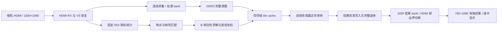

# 项目说明与数据通路

## 本版目标及边界

本版实现基于四个黑色角标的平面文档透视校正：完整 1080p 图像采集进入 DDR，检测四角质心，由 B 定点单应性求解及双线性插值生成竖向结果，通过 HDMI 输出。该版本属于待完善板级验收的整机候选。

四个黑块必须分别位于固定搜索区；算法对区域内全部命中黑像素求质心。正文、阴影或背景黑块进入 ROI 会干扰，并非任意位置的纸张识别或自由旋转跟踪。镜头径向/切向畸变标定、曲面展开和 OCR 不在本版实现范围。

## 数据流

帧号、bank 所有权与写回确认用于防止覆盖仍在使用的数据。无合法新角标时拒绝发布并保留旧的完整结果，观察 FRAME 和 AGE/HELD 才能区分静止目标与停更旧帧。

## 固定配置

| 项目 | 本版值 |
|---|---|
| 板级顶层 | video_correct_ddr_top |
| 系统控制边界 | video_correct_ddr_continuous_core |
| 逻辑/板卡器件 | PG2L100H -6 FBG676（工程标注 MES2L676-100HP） |
| 系统参考 | 27 MHz |
| 视频扫描像素时钟 | 148.5 MHz |
| 处理时钟 | 742.5/13 ≈ 57.115385 MHz |
| HDMI 配置时钟 | 约 10 MHz |
| DDR UI | 125 MHz（原工程配置/约束） |
| 输入/源图 | 1920×1080，每个有效像素保留 |
| 存储像素 | RGB888 存入 RGB32 字 |
| 逻辑校正结果 | 765×1080 |
| 结果存储 | 768×1080：左 1 列、右 2 列为对齐黑边 |
| HDMI 画布 | 1920×1080，结果居中；画布不强行拉伸文档比例 |
| 黑色阈值 | R/G/B 各通道 0～64 |
| 黑块面积/跨度 | 64～16384 个命中像素；跨度不超过 256 |

上述频率为设计配置及模型/约束值，未进行本次板上频率仪器测量。画面能显示不代表全部任务指标已验收。

## 来源分工

本版为 C 的整机候选，承接 A 的板级/DDR整合基础及 B 的单应性、坐标和插值算法。源码保留原注释与厂商版权。审核时依据文件和提交记录评估贡献，不将本包全部源文件都归为某一个人的独立开发成果。
