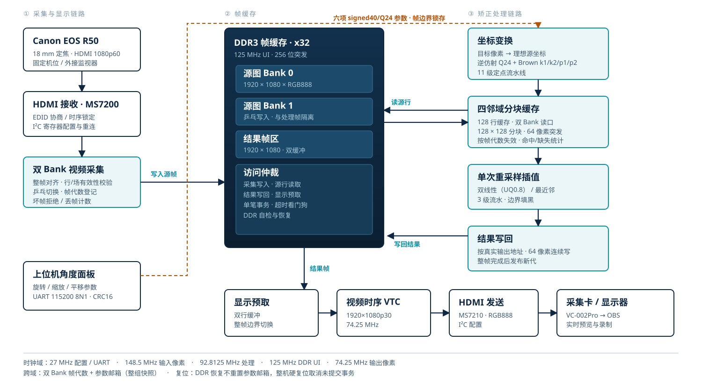
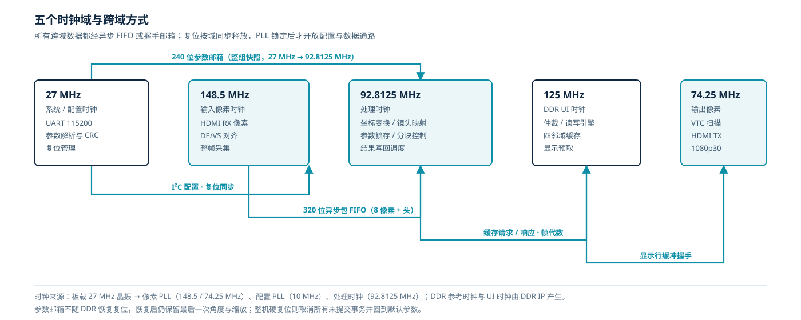
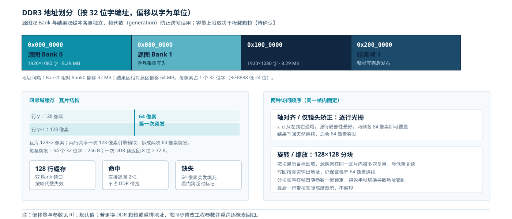
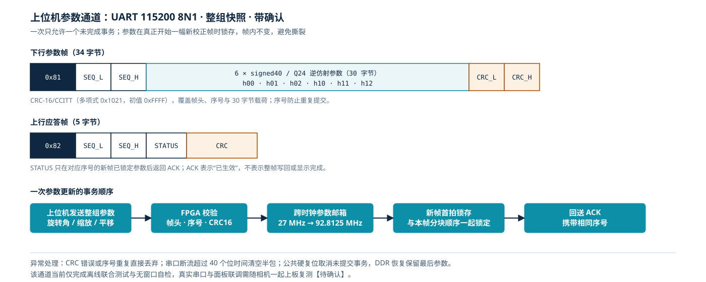
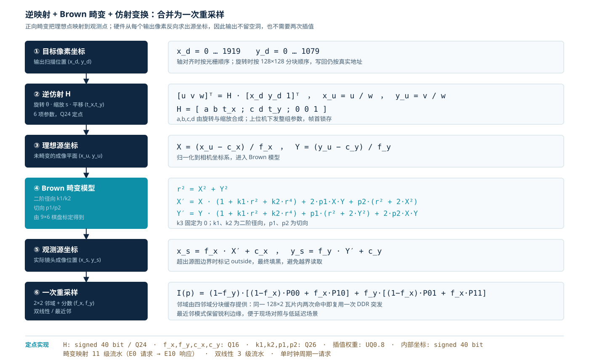
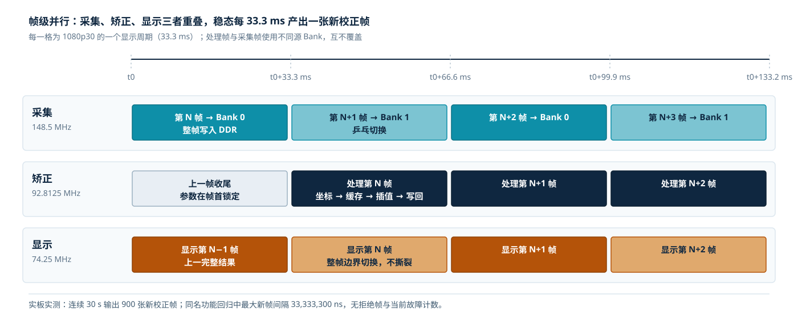

# 基于 Logos-2 FPGA 的实时镜头畸变矫正与角度控制系统

## 技术报告（竞赛初稿 v0.1）

**作品名称：** 基于 Logos-2 FPGA 的实时镜头畸变矫正与角度控制系统

**参赛队：** ＿＿＿＿＿＿＿＿（提交前填写）

**完成日期：** 2026 年 11 月

**文档状态：** 初稿。文中标注【待确认】处必须以实测数据补齐后再对外提交。

<!-- pagebreak -->

## 摘要

广角镜头在工业检测、医疗内窥、机器视觉和消费影像中被大量使用，但其固有的径向与切向畸变会使直线弯曲、边缘尺度失真，直接影响测量与识别。通用处理器做高分辨率逐像素矫正时，带宽和实时性都难以兼顾；GPU 方案功耗高、时序不确定。

本作品在紫光同创 Logos-2 PG2L100H FPGA 上实现了一条完整的实时视频矫正链路：HDMI 1080p60 输入经双 Bank 采集写入外挂 DDR3，处理单元对每个输出像素做"逆仿射 + Brown 畸变"合并映射，再由四邻域分块缓存取数，完成一次双线性或最近邻重采样，结果写回 DDR 并按 1080p30 扫描输出。系统同时提供 UART 上位机通道，可在不中断画面的前提下更新旋转、缩放和平移参数。

关键设计包括：把镜头畸变与仿射变换合并为一次重采样，避免二次插值带来的额外模糊；用 128×2 像素瓦片、128 行缓存与 64 像素突发降低 DDR 重复读取；参数以整组快照在帧边界锁存，切换角度时不出现半帧撕裂。实板连续 30 秒实测输出 900 张新校正帧，物理实现最小裕量为 +0.035 ns，逐像素回归、定点数值对照和综合网表对照均已通过。

**关键词：** FPGA 视频处理；镜头畸变矫正；单次重采样；DDR3 帧缓存；帧同步参数切换


## 目录

1. 项目背景与意义
2. 系统总体设计
3. 硬件平台与接口
4. 畸变矫正算法与定点实现
5. 关键模块设计
6. 系统工作流程
7. 测试方法与结果
8. 创新点
9. 应用价值
10. 总结与展望
附录 A 术语表
附录 B 关键参数表
附录 C 证据索引
附录 D 待补充数据与材料


## 1 项目背景与意义

### 1.1 问题背景

相机成像模型可以近似为针孔模型，但真实镜头总存在偏差。广角或大光圈镜头为了让更多场景进入画面，会引入明显的桶形畸变：画面边缘的直线向外弯曲，中心与边缘的比例尺不一致。切向畸变则来自镜头组装配误差，使图像产生轻微倾斜和拉伸。两类误差叠加后，同一物体在画面不同位置的像素尺寸可能相差数个百分点。

对于"看"的应用，这种误差会向下游传播：

- 尺寸测量与定位直接把像素误差换算成毫米误差；
- 多相机拼接、AR 叠加和投影校正依赖准确的像素对应关系；
- 医疗内窥、工业内窥等场景需要在不损失帧率的前提下实时矫正；
- 直播、影视和无人机图传希望矫正后仍保持低延迟和稳定画质。

### 1.2 为什么选择 FPGA

逐像素矫正本质上是"对每个输出像素求一个源坐标，再做一次二维插值"。1080p30 每秒约 6220 万个输出像素，每个像素需要多次乘加和 4 个邻域像素读取。通用 CPU 受缓存与内存带宽限制，GPU 虽然吞吐高，但存在调度抖动、功耗和平台依赖。

FPGA 的优势在于：

1. **确定性时序**：像素按扫描顺序流入流出，流水线级数固定，不经过操作系统调度；
2. **并行访存**：多路 DDR 请求可以在硬件仲裁下重叠，缓存命中直接返回；
3. **接口原生**：HDMI、DDR3、UART 都能在片内直接对接，整机可以独立工作；
4. **功耗与成本可控**：本设计资源占用约为 LUT 59%、块存储 62%，仍留有扩展空间。

### 1.3 本作品的目标

在单块 MES2L676-100HP 开发板上，完成"相机 HDMI 输入 → 帧缓存 → 畸变与仿射矫正 → HDMI 输出"的完整闭环，达到 1920×1080、每秒 30 张新校正画面，并支持上位机实时调整观察角度与缩放。作品不依赖 PC 参与图像处理，PC 只负责发送参数和显示结果。


## 2 系统总体设计

### 2.1 设计指标

| 项目 | 指标 | 当前状态 |
| --- | --- | --- |
| 输入分辨率 | 1920×1080，RGB888，60 Hz | 已实现 |
| 输出分辨率 | 1920×1080，30 Hz 扫描 | 已实现 |
| 新校正帧率 | 30 帧/秒 | 实板 30 秒 900 帧 |
| 处理时钟 | 92.8125 MHz | 已实现 |
| DDR 接口 | 外挂 DDR3，x32，UI 125 MHz | 已实现 |
| 畸变模型 | Brown：k1、k2、p1、p2（k3=0） | 已实现 |
| 重采样 | 双线性 / 最近邻，单次采样 | 已实现 |
| 参数通道 | UART 115200 8N1，240 位整组快照 | 功能回归通过 |
| 物理时序 | 全部摘要非负 | 最小裕量 +0.035 ns |
| 端到端延迟 | 目标 ≤ 1 帧 | 【待确认】 |

### 2.2 系统组成

系统由五部分组成（图 1）：

1. **视频输入**：相机 HDMI 经 MS7200 接收芯片进入 FPGA，恢复像素时钟、DE、HS、VS 和 24 位 RGB 数据；
2. **帧缓存**：双 Bank 采集把整帧按 256 位突发写入 DDR3，处理与显示分别读取不同区域；
3. **矫正处理**：坐标变换模块把目标像素映射到源像素，四邻域缓存负责取数，插值模块完成重采样，结果写回 DDR；
4. **视频输出**：显示预取从结果区读出整帧，VTC 产生 1080p30 时序，MS7210 发送 HDMI；
5. **控制与人机接口**：27 MHz 域解析 UART 参数，经跨时钟邮箱送入处理域，在帧边界锁存。



### 2.3 时钟域与复位

系统包含五个时钟域（图 6）：

| 时钟 | 频率 | 主要用途 |
| --- | --- | --- |
| 系统/配置 | 27 MHz | UART、参数解析、I²C 配置、复位管理 |
| 输入像素 | 148.5 MHz | HDMI 接收、整帧采集 |
| 处理 | 92.8125 MHz | 坐标变换、缓存控制、写回调度 |
| DDR UI | 125 MHz | 仲裁、读写引擎、四邻域缓存、显示预取 |
| 输出像素 | 74.25 MHz | VTC 扫描、HDMI 发送 |

所有跨域数据都经过异步 FIFO 或握手邮箱：采集数据用 320 位异步包 FIFO（8 像素 + 64 位头），参数用 240 位整组快照邮箱，缓存请求与响应用带帧代数的握手。复位按域同步释放，只有像素 PLL 与配置 PLL 都锁定后才开放数据通路；DDR 恢复流程不会重置参数邮箱，因此恢复后仍保留最后一次角度与缩放，而整机硬复位会取消所有未提交事务。




## 3 硬件平台与接口

### 3.1 开发板与器件

| 项目 | 配置 |
| --- | --- |
| 开发板 | MES2L676-100HP |
| FPGA | 紫光同创 Logos-2，PG2L100H-6IFBG676 |
| 开发工具 | PDS 2022.2-SP6.4，综合引擎 Pango ADS |
| 仿真工具 | ModelSim SE-64 2020.4 |
| 板载晶振 | 27 MHz |
| 外挂存储 | DDR3，32 位数据总线 |
| 视频接口 | HDMI 输入 MS7200，HDMI 输出 MS7210 |
| 串口 | 板载 CP2102，FPGA RX=B24 / TX=C24，3.3 V |

### 3.2 视频通路

相机为 Canon EOS R50，配 18 mm 镜头，输出 1920×1080@60 Hz HDMI。接收芯片通过 I²C 配置，FPGA 侧使用 148.5 MHz 像素时钟采样。输出端由 MS7210 驱动，像素时钟 74.25 MHz，对应 1080p30 扫描；显示帧率低于输入帧率，是为了给逐像素矫正留出完整的一帧处理时间。

### 3.3 存储与带宽

DDR3 被划分为源图 Bank 0、源图 Bank 1、结果帧 0 和结果帧 1（图 4）。源图按 32 位字、每像素一字存放；一次读返回 8 拍，每拍 32 字节，即 256 位。写回使用 64 像素连续突发，保证地址连续、行切换少。



### 3.4 上位机接口

PC 端角度面板通过 USB 转串口发送六项 signed40/Q24 逆仿射系数（h00、h01、h02、h10、h11、h12）。帧格式为 0x81 + 16 位序号 + 30 字节载荷 + CRC16，共 34 字节；FPGA 校验通过后写入参数邮箱，并在下一幅新校正帧开始时锁存，随后回送带相同序号的 ACK。




## 4 畸变矫正算法与定点实现

### 4.1 相机模型

设空间点在相机坐标系下的归一化坐标为 (X, Y)，理想针孔投影到像素平面为：

```
u = fx · X + cx
v = fy · Y + cy
```

考虑径向与切向畸变后，实际成像位置 (X′, Y′) 为：

```
r² = X² + Y²
X′ = X · (1 + k1·r² + k2·r⁴) + 2·p1·X·Y + p2·(r² + 2·X²)
Y′ = Y · (1 + k1·r² + k2·r⁴) + p1·(r² + 2·Y²) + 2·p2·X·Y
```

其中 k1、k2 为径向系数，p1、p2 为切向系数。本设计固定 k3=0，与标定数据一致。

### 4.2 逆映射：从输出反查输入

若按正向思路，对源图每个像素计算它落到输出的位置，会出现输出空洞和重复写入。工程上采用逆映射：遍历每个**输出**像素 (x_d, y_d)，先经仿射变换得到理想源坐标 (x_u, y_u)，再套用上述畸变公式得到实际采样坐标 (x_s, y_s)，最后在该位置取 2×2 邻域插值。

注意这里并不需要求解畸变的解析逆：畸变公式本身就是"理想 → 观测"的正向映射，而我们需要的正是"理想坐标对应的观测像素位置"，因此直接代入即可。这一步把"去畸变"和"按角度观察"统一成了同一条坐标链路。

### 4.3 与仿射变换合并

上位机希望在不移动相机的情况下改变观察角度和缩放。设目标像素经 3×3 齐次矩阵 H 映射：

```
[u v w]ᵀ = H · [x_d y_d 1]ᵀ
x_u = u / w,  y_u = v / w
H = [ a b tx ; c d ty ; 0 0 1 ]
```

a、b、c、d 由旋转角与缩放合成，tx、ty 为平移。H 与镜头模型串联后，输出像素只做**一次**双线性采样，而不是"先旋转一次、再去畸变一次"。两次采样会叠加两次低通，边缘会更糊，也会多消耗一倍的缓存带宽。



### 4.4 定点化

FPGA 不做浮点，所有参数按定点表示：

| 量 | 格式 | 说明 |
| --- | --- | --- |
| 仿射系数 H | signed 40 bit / Q24 | 6 项，UART 下发 |
| 内参 fx、fy、cx、cy | Q16 | 编译期常量 |
| 畸变系数 k1、k2、p1、p2 | Q26 | 编译期常量 |
| 插值权重 | UQ0.8 | 8 位小数 |
| 内部坐标 | signed 40 bit | 保留 8 位亚像素 |

定点误差的控制方法是：先用 Python 模型生成逐像素期望值，再与 RTL 仿真逐像素比对；对坐标链路还额外做了约 7,968 组随机参数请求的数值对照。映射结果超出源图范围时标记 outside 并填黑，避免越界读取。

### 4.5 插值

双线性插值使用 2×2 邻域和 UQ0.8 权重：

```
I(p) = (1−fy)·[(1−fx)·P00 + fx·P10] + fy·[(1−fx)·P01 + fx·P11]
```

最近邻模式直接取左上邻域，用于现场对照和低延迟场景。两种模式共用同一条坐标与缓存链路，切换只改变末端选择。

### 4.6 标定

标定使用 9×6 内角点棋盘（54 个角点），在 1920×1080 原生分辨率下采集。当前 18 mm 试标定结果：

| 参数 | 数值 |
| --- | --- |
| fx | 1599.09 px |
| fy | 1596.44 px |
| cx | 933.50 px |
| cy | 525.27 px |
| k1 | 0.011398 |
| k2 | −0.050860 |
| p1 | −0.004072 |
| p2 | −0.003619 |
| 训练集重投影 RMS | 1.387 px |
| 独立验证集 RMS | 1.449 px |
| 留出直线度（原始 → 矫正） | 0.653 px → 0.629 px |

该组参数来自真实 HDMI 采集的试标定，但拍摄时的锁焦状态、机内矫正与防抖设置尚未完全确认，因此标定文件保留 `deploy_to_fpga=false` 标记，不能据此宣称已完成独立光学验收。


## 5 关键模块设计

### 5.1 视频接收与双 Bank 采集

接收模块以 VS 上升沿作为帧起点，逐行检查 DE 与像素计数；只有行数、列数和采样计数都符合 1920×1080 时才承认整帧有效。两个源 Bank 采用乒乓机制：处理读取 Bank N 时，采集写入 Bank N+1；每次分配都带帧代数（generation），下游释放时必须带回相同代数，防止旧帧误释放新帧。

数据打包为 320 位：64 位头（类型、Bank、代数、坐标）加 8 个 RGB888 像素。队列为 8 项，其中 4 项保留给控制记录，避免下游满时丢失帧结束事件。

### 5.2 DDR 仲裁与读写引擎

DDR 侧有四类请求：采集写入、源行读取、结果写回、显示预取。仲裁器按单笔事务调度，任何一笔都有看门狗超时；超时后置故障位并按恢复流程重新初始化，而不是让整机静默卡死。启动阶段执行 DDR 自检，确认保留区可读写后再开放数据通路。

读写引擎把 256 位一拍的数据拼成 8 拍一组，源行按 64 字对齐读取；结果区按 64 像素连续写。地址统一按 32 位字编址，便于与缓存、写回器共用一套计算。

### 5.3 坐标变换流水线

坐标模块对每个目标像素依次做：仿射乘加、归一化、径向多项式、切向修正、反归一化，共 11 级寄存器。设计上把"径向乘法"和"常数加法"用一个精确乘积边界隔开，避免长组合路径拖慢时钟；旁路模式与正常模式保持相同延迟，便于逐像素对齐比较。

模块内部不使用除法器：归一化所需的 1/fx、1/fy 以 Q30 常量预先算好，乘法后移位即可。这样既省资源，也让延迟完全确定。

### 5.4 四邻域分块缓存

每个输出像素需要 2×2 邻域，相邻像素之间高度重叠。缓存以 128×2 像素为瓦片，一次填充覆盖两行；128 行容量、双 Bank 读口，可以在一个周期内取回四个邻域。瓦片按帧代数失效：新帧第一笔请求会先作废旧标签，避免跨帧命中。

地址顺序有两种：轴对齐（只做镜头矫正）按光栅逐行；旋转或缩放时按 128×128 分块，让源行在块内被反复命中。两种顺序都在帧首与参数一起锁定，半帧不会切换。

### 5.5 结果写回与显示

写回器按真实输出地址写入，每笔 64 像素连续，保证 DDR 行内突发效率。整帧写完后才发布新代数；显示端在帧边界切换到新结果，未完成时重复上一完整帧。这样即使某一帧处理超时，画面也只是短暂停顿，不会出现撕裂或半帧花屏。

### 5.6 上位机参数通道

UART 模块实现一个"停等"事务：一次只允许一个未完成请求，收到完整帧后校验帧头、序号与 CRC16；通过后写入邮箱。邮箱跨 27 MHz 与 92.8125 MHz，源端载荷保持稳定直到目的端在帧边界消费并回传确认。ACK 的语义是"新帧已锁定参数"，不表示整帧已写回或显示完成，这一点在上位机状态栏中单独提示。

### 5.7 复位与恢复

系统有三类复位：上电硬复位、DDR 故障恢复复位、应用层软复位。硬复位取消所有未提交事务并回到默认参数；DDR 恢复只重置存储相关状态，参数邮箱保留；软复位用于清空当前帧而不影响已锁定参数。所有复位都在各自时钟域内同步释放，避免异步撤销造成亚稳态。


## 6 系统工作流程

### 6.1 上电启动

1. 27 MHz 时钟起振，像素 PLL 与配置 PLL 锁定；
2. 配置模块通过 I²C 初始化 MS7200 与 MS7210，读取芯片 ID 并检查 ACK；
3. DDR 控制器完成上电校准与自检；
4. 显示端先输出彩条；第一张完整校正帧到达后切换到真实画面；
5. 串口等待上位机参数；未收到参数时使用默认单位矩阵。

### 6.2 单帧处理

1. VS 上升沿，采集模块申请空闲 Bank；
2. 整帧写入 DDR，写入完成后登记帧代数；
3. 处理模块在帧首锁存当前参数与访问顺序，逐块/逐行发出坐标请求；
4. 缓存命中直接返回 2×2；缺失则发 64 像素突发，读回后填充；
5. 插值结果按真实地址写回结果区；
6. 整帧写完，发布新代数；显示端在下一个帧边界切换。

采集、处理、显示三条流水在稳态下完全重叠（图 2），因此新校正帧率由最慢的一段决定，而不是三者之和。

### 6.3 参数更新

上位机拖动角度滑块 → 计算新的六项 Q24 系数 → 发送 34 字节帧 → FPGA 校验并写入邮箱 → 下一幅新帧首拍锁存 → 回送 ACK。整个过程不打断当前帧，画面只在帧边界变化。




## 7 测试方法与结果

### 7.1 四层证据

为了避免"仿真通过就当成实板通过"，本项目把证据分成四层，任何一层都不能替代另一层：

| 层级 | 内容 | 作用 |
| --- | --- | --- |
| 数值模型 | Python 定点/浮点参考 | 生成逐像素期望值 |
| RTL 仿真 | ModelSim 全链路 1080p 回归 | 验证时序、握手、边界 |
| 综合网表 | 用实际综合后的网表做整数对照 | 排除综合优化差异 |
| 实板 | 下载、回读、录像、逐帧统计 | 证明真实链路工作 |

### 7.2 实板结果

2026-10-29 的固定镜头版本在真实相机、真实 DDR、真实 HDMI 链路上完成 30 秒连续测试：

| 指标 | 结果 |
| --- | --- |
| 连续运行时间 | 30 s |
| 新校正帧数 | 900 帧 |
| 平均新帧率 | 30 帧/秒 |
| 拒绝帧 / 当前故障 | 0 / 0 |
| 物理时序最小裕量 | +0.035 ns |
| 建立 / 保持最小裕量 | +0.12 ns / +0.081 ns |
| IO 核对 | 142 个引脚全部匹配 |

录像中包含一次按键复位：复位后约 2.07 秒无法解码 HUD，该区间包含采集卡重新锁定时间，不能当作 FPGA 复位延迟。剔除这一窗口后，测量段内 900 帧连续输出，拒绝帧与当前故障计数均为零；棋盘格在矫正窗口内正常显示，未出现退回彩条。需要说明的是，该版本只做固定镜头矫正与固定视口裁剪，画面中的倾斜棋盘**没有**被透视拉正。

### 7.3 功能回归

同一套源码在五类 1920×1080 全视频场景下通过逐像素核对：

| 场景 | 参数 | 结果 |
| --- | --- | --- |
| 0° 双线性 | 默认视角 | 通过，≥6 张新帧 |
| 90° 双线性 | 旋转 90° | 通过 |
| 逐帧切换 | 0° / 90° 交替 | 通过，帧边界生效 |
| 原图旁路 | RAW | 通过 |
| 12° 最近邻 | 小角度 + 最近邻 | 通过 |

此外还完成了约 7,968 组仿射/镜头数值请求对照、640 次与冻结旧链路的逐像素比较、16,384 像素的"串口到真实运算管线"联合测试，以及 4,075 组针对实际综合网表镜头单元的整数对照。

### 7.4 资源占用

| 资源 | 使用 | 总量 | 占比 |
| --- | --- | --- | --- |
| LUT | 27,464 | 46,700 | 59% |
| FF | 41,922 | 93,400 | 45% |
| 块存储 DRM | 95 | 155 | 62% |
| 乘法器 APM | 67 | 240 | 28% |
| IO | 142 | 300 | 48% |
| CLMA | 10,499 | 11,675 | 90% |

逻辑阵列占用接近九成，说明当前版本已经接近该器件的布局上限；后续若增加透视求解或更高帧率，需要先做面积优化或更换更大器件。

### 7.5 结果边界

以下内容**尚未**完成，报告中不作为已实现指标：

- 场景自适应的透视矫正（自动识别棋盘并拉正）：离线全链路 30 fps 已通过，最终物理时序未收敛；
- 上位机角度/缩放版本的板级验收：软件功能回归通过，但原生时序仍为负（DDR PHY 最差 −2.391 ns），因此没有作为提交码流；
- 真实光学指标（SFR/MTF50）、端到端延迟、30 分钟以上稳定性、HDMI 热插拔与冷启动恢复；
- 独立拍摄条件下的重新标定与光学精度验证。


## 8 创新点

**关键词一：单次重采样融合。** 把"镜头去畸变"和"角度/缩放变换"合并成一条逆映射，输出像素只采样一次。相比先旋转再去畸变的串联做法，减少一次插值、少一次缓存往返，边缘更锐利，带宽也更低。

**关键词二：分块缓存复用。** 以 128×2 像素瓦片和 128 行缓存承接 2×2 邻域请求，旋转时按 128×128 分块遍历，使源行在块内反复命中；写回仍按真实地址做 64 像素连续突发。该结构在有限块存储下同时兼顾了随机访问局部性和 DDR 突发效率。

**关键词三：帧同步参数切换。** 六项仿射系数以整组快照跨时钟传递，只在真正开始一幅新校正帧时锁存；ACK 与帧开始严格对应。用户拖动角度时画面不会出现半帧旧参数、半帧新参数的撕裂，也不需要停流重配。

此外，项目建立了"数值模型 → RTL 仿真 → 综合网表 → 实板录像"的四层证据链，所有结论都能追溯到具体源码哈希与测试记录，这在学生作品中并不常见，也为后续迭代提供了可复现的基线。

## 9 应用价值

- **工业视觉**：广角相机用于大视野检测时，边缘尺寸误差可直接用本方案在线矫正，无需更换昂贵低畸变镜头；
- **医疗与内窥**：实时矫正可减轻医生对弯曲画面的适应负担，低延迟特性适合手持操作；
- **AR/VR 与投影**：投影仪梯形校正、头显透视校正都依赖稳定的像素映射，本架构可扩展到多参数切换；
- **消费影像与直播**：相机直出 HDMI 后经 FPGA 处理，不占用 PC 资源，适合多机位或嵌入式场景；
- **教学与竞赛**：完整展示了从相机模型、定点化、缓存设计到时序收敛的工程闭环，可作为 FPGA 视频处理的参考实现。

## 10 总结与展望

本作品完成了 1080p60 输入、1080p30 输出的实时镜头畸变矫正系统：以 DDR3 双 Bank 缓存承接整帧，以合并逆映射和单次重采样保证画质，以分块缓存和 64 像素突发保证带宽，以帧边界参数快照保证切换稳定。实板 30 秒 900 帧、物理时序全正、逐像素回归通过，构成了可复现的交付基线。

后续工作按优先级排列：

1. 完成上位机角度版本的时序收敛，使其具备与固定镜头版同等的板级资格；
2. 将自动棋盘透视矫正接入正式顶层，补齐场景自适应能力；
3. 在固定焦距、关闭机内矫正与防抖的条件下重新标定，补测 SFR/MTF50 与端到端延迟；
4. 优化逻辑面积与缓存结构，争取在同等器件上支持 60 帧或更高分辨率；
5. 增加长时间运行、热插拔与冷启动恢复测试，形成完整验收报告。


## 附录 A 术语表

| 术语 | 说明 |
| --- | --- |
| Brown 模型 | 包含径向 k1/k2/k3 与切向 p1/p2 的镜头畸变模型 |
| 逆映射 | 从输出像素反查源像素坐标的采样方式 |
| 单次重采样 | 输出像素只做一次插值，避免多次滤波叠加 |
| Bank | DDR 中独立的一块帧缓冲，用于乒乓采集 |
| 帧代数 | 标识帧归属的递增编号，防止跨帧误用 |
| 瓦片 | 缓存填充的基本矩形区域，本设计为 128×2 像素 |
| Q24 / Q26 / UQ0.8 | 定点数格式，分别表示 24、26、8 位小数 |

## 附录 B 关键参数表

| 参数 | 数值 |
| --- | --- |
| 输入时序 | 1920×1080@60，148.5 MHz |
| 输出时序 | 1920×1080@30，74.25 MHz |
| 处理时钟 | 92.8125 MHz |
| DDR UI | 125 MHz，32 位 |
| 仿射参数 | 6 × signed40 / Q24 |
| 畸变参数 | k1=0.011398，k2=−0.050860，p1=−0.004072，p2=−0.003619 |
| 内参 | fx=1599.09，fy=1596.44，cx=933.50，cy=525.27 |
| 流水线 | 坐标 11 级，插值 3 级 |
| 缓存 | 128 行，瓦片 128×2，突发 64 像素 |
| 串口 | 115200 8N1，CRC16-CCITT |

## 附录 C 证据索引

| 证据 | 路径 |
| --- | --- |
| 实板验收结果 | `C:\D\FPGA\A_board_20261029\hardware_acceptance_20261029_225412\stage_acceptance_result.json` |
| 候选资格与时序 | `C:\D\FPGA\A_board_20261029\candidate_de_frame_guard_v2\candidate_qualification.json` |
| 实板录像 | `C:\D\FPGA\A_board_20261029\hardware_acceptance_20261029_225412\source.mp4` |
| 标定数据 | `C:\D\FPGA\A_lens_20261030\calibration\r50_18mm_hdmi_trial.json` |
| 五类视频回归 | `C:\D\FPGA\A_lens_20261030\verification\video_20261030_135116_949527_71c14726\verification.json` |
| 当前状态与交接 | `C:\D\FPGA\A_lens_20261030\CURRENT_STATE.json`、`交接说明_20261030_暂停.md` |
| 资源报告 | `...\build\pds_selected_20261029_181422\input\selected_resources.prr` |

## 附录 D 待补充数据与材料

| 项目 | 说明 | 负责人 |
| --- | --- | --- |
| 最终提交码流 | 确认提交 10-29 固定镜头版或后续收敛版本，并记录 SHA256 | A |
| 真实端到端延迟 | 相机到显示器的物理延迟，需高速拍摄或光电计时 | A/C |
| SFR / MTF50 | 斜边法实测矫正前后锐度 | B |
| 30 分钟稳定性 | 连续运行、温度、是否丢帧 | C |
| 冷启动与热插拔 | 断电重启、HDMI 重连恢复 | C |
| 实拍前后对比图 | 同一场景矫正前/后、RAW/矫正并排 | B |
| 实物照片 | 全貌 1 张 + 开发板重要角度最多 4 张 | 全员 |
| 演示视频 | 按脚本拍摄、剪辑、配音、字幕 | 全员 |
| 标定复测 | 固定焦距、关闭机内矫正后的独立标定 | B |
